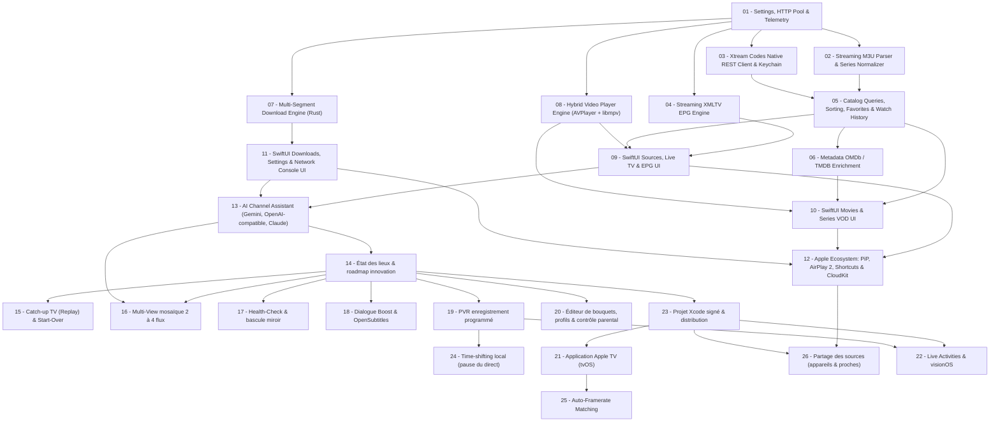

# 00 — Index & Roadmap d'Exécution pour Agents IA (`cnd-iptv-native`)

> **Rôle de l'Agent IA :** Tu es un ingénieur logiciel Staff / Senior spécialisé en **Rust (Tokio, SQLite, FFI)** et **Écosystème Natif Apple (Swift 6, SwiftUI, AppKit/UIKit, AVFoundation, libmpv/VideoToolbox)**.  
> **Règle d'or :** Chaque fichier `PRD/*.md` de ce dossier décrit **une fonctionnalité atomique ("one-by-one")** à implémenter, tester et valider de bout en bout avant de passer au suivant.

---

## 1. État Actuel du Projet (Baseline Phase 1 — Déjà Implémenté ✅)

Le squelette monorepo `cnd-iptv-native/` est déjà initialisé et fonctionnel :
- **Workspace Rust** (`Cargo.toml`) avec `crates/cnd-core` et `crates/cnd-cli`.
- **Base SQLite WAL + FTS5** (`crates/cnd-core/src/db/schema.rs` & `mod.rs`) : toutes les tables de base (`iptv_sources`, `series_catalog`, `iptv_items`, `iptv_items_fts`, `epg_programs`, `favorites`, `watch_history`, `download_tasks`, `download_parts`, `download_logs`) sont créées.
- **Pont FFI UniFFI** (`crates/cnd-core/src/lib.rs`) : objet `CndEngine` exporté avec `new`, `in_memory`, `get_stats`, `add_source`, `list_sources`, `toggle_favorite`, `query_items`.
- **Script XCFramework Universel** (`scripts/build-xcframework.sh`) : compile `macOS (arm64 + x86_64)`, `iOS Simulator (arm64 + x86_64)` et `iOS Device (arm64)` vers `apple/Packages/CndCoreBridge/cnd_coreFFI.xcframework`.
- **App SwiftUI Multiplateforme** (`apple/Package.swift` & `apple/Sources/CndIptvApp/`) : `CndIptvApp`, `AppState` (`@Observable`) et `ContentView` compilent sur macOS et iOS Simulator.

---

## 2. Directives Globales Obligatoires pour Tous les Agents IA

1. **Zéro Technologie Web ou Script dans l'App :** Uniquement Rust, Swift/SwiftUI et C/C++ (pour `libmpv`/`FFmpeg`).
2. **Anti-OOM (Streaming Obligatoire) :** Ne **jamais** charger un fichier M3U, XMLTV ou payload JSON massif intégralement en mémoire (`String` / `Vec<u8>`). Toujours utiliser des flux asynchrones (`reqwest::Response::bytes_stream()` + `StreamReader` / `AsyncBufRead`) et insérer dans SQLite par lots transactionnels (`2 000` à `5 000` lignes).
3. **Isolation Stricte du Main Thread (`@MainActor`) :** Côté SwiftUI, aucun accès disque, réseau ou FFI synchrone lourd sur le Main Thread. Tout appel vers `CndEngine` doit être exécuté hors du Main Thread (fonctions UniFFI `async` ou `Task.detached`), et seules les mutations d'état UI reviennent sur `@MainActor`.
4. **Synchronisation du Bridge FFI :** Dès qu'une signature publique `#[uniffi::export]`, `#[derive(uniffi::Record)]`, `#[derive(uniffi::Enum)]` ou `#[derive(uniffi::Error)]` est ajoutée ou modifiée dans `cnd-core`, l'agent **DOIT** relancer `./scripts/build-xcframework.sh` et vérifier `swift test` + `xcodebuild`.
5. **Qualité & Zéro Régression :** Un PRD n'est terminé que lorsque :
   - `cargo test --workspace` passe à 100 %.
   - `cargo clippy --workspace -- -D warnings` ne remonte aucune erreur.
   - `./scripts/build-xcframework.sh` réussit (si `cnd-core` a changé).
   - Les builds `xcodebuild` macOS **et** iOS Simulator réussissent (`** BUILD SUCCEEDED **`).

---

## 3. Graphe de Dépendances des PRDs

---

## 4. Liste Séquentielle des Features (One-by-One)

| Ordre | Fichier PRD | Périmètre Principal | Statut |
| :---: | :--- | :--- | :---: |
| **01** | [`01_CORE_TELEMETRY_HTTP_SETTINGS.md`](./01_CORE_TELEMETRY_HTTP_SETTINGS.md) | `RuntimeSettings` persistés, Pool HTTP `reqwest` Keep-Alive, Ring-Buffer de logs réseau (`Telemetry`). | `[x]` |
| **02** | [`02_STREAMING_M3U_INGESTION_SERIES_NORMALIZER.md`](./02_STREAMING_M3U_INGESTION_SERIES_NORMALIZER.md) | Parseur M3U/Kodi/VLC en streaming, détection `live`/`movie`/`episode`, normalisation `series_catalog`, batch SQLite. | `[x]` |
| **03** | [`03_XTREAM_CODES_NATIVE_CLIENT.md`](./03_XTREAM_CODES_NATIVE_CLIENT.md) | Client REST JSON `player_api.php` haute vitesse, fallback M3U+, intégration Keychain Apple pour les mots de passe. | `[x]` |
| **04** | [`04_XMLTV_EPG_ENGINE.md`](./04_XMLTV_EPG_ENGINE.md) | Parseur XMLTV streaming (`.xml` / `.xml.gz`), indexation programmes TV, requêtes *Now/Next* et grille horaire. | `[x]` |
| **05** | [`05_CATALOG_QUERIES_FAVORITES_HISTORY.md`](./05_CATALOG_QUERIES_FAVORITES_HISTORY.md) | Filtres Groupes/Hosts, Tris dynamiques, Catalogue Séries Saisons/Épisodes, Favoris globaux & Reprise VOD (`watch_history`). | `[x]` |
| **06** | [`06_METADATA_OMDB_TMDB_ENRICHMENT.md`](./06_METADATA_OMDB_TMDB_ENRICHMENT.md) | Extraction Titre/Année propre, client OMDb/TMDB avec cache SQLite, enrichissement à la demande des Films & Séries. | `[x]` |
| **07** | [`07_MULTI_SEGMENT_DOWNLOAD_ENGINE.md`](./07_MULTI_SEGMENT_DOWNLOAD_ENGINE.md) | `Prober` HTTP Range, téléchargement parallèle sans verrou (`pwrite`), file `Semaphore`, pause/reprise atomique, EMA débit/ETA. | `[x]` |
| **08** | [`08_HYBRID_VIDEO_PLAYER_ENGINE.md`](./08_HYBRID_VIDEO_PLAYER_ENGINE.md) | Dual-Engine `AVPlayer` + `libmpv` (`VideoToolbox`), Stall Watchdog `NWPathMonitor`, multi-pistes, Playlist Saison, VLC/IINA. | `[x]` |
| **09** | [`09_SWIFTUI_SOURCES_LIVE_TV_EPG.md`](./09_SWIFTUI_SOURCES_LIVE_TV_EPG.md) | UI SwiftUI complète : Gestion Sources (CRUD + Drag & Drop), Live TV (Grille/Liste, Filtres, EPG Now/Next, Mini-Player). | `[x]` |
| **10** | [`10_SWIFTUI_MOVIES_SERIES_VOD.md`](./10_SWIFTUI_MOVIES_SERIES_VOD.md) | UI SwiftUI VOD : Posters downsamplés 120 fps, Détails Film OMDb, Détails Série par Saisons, lecture & téléchargement 1-clic. | `[x]` |
| **11** | [`11_SWIFTUI_DOWNLOADS_SETTINGS_CONSOLE.md`](./11_SWIFTUI_DOWNLOADS_SETTINGS_CONSOLE.md) | UI SwiftUI Téléchargements (batch, Bookmarks macOS, Fichiers iOS, LogsSheet), Réglages complets & Console Réseau pliable. | `[x]` |
| **12** | [`12_APPLE_ECOSYSTEM_PIP_AIRPLAY_CLOUDKIT.md`](./12_APPLE_ECOSYSTEM_PIP_AIRPLAY_CLOUDKIT.md) | Picture-in-Picture système, AirPlay 2, `MPNowPlayingInfoCenter`, Raccourcis/Gestes zapping & Sync iCloud (`CKSyncEngine`). | `[x]` |
| **13** | [`13_AI_CHANNEL_ASSISTANT.md`](./13_AI_CHANNEL_ASSISTANT.md) | Assistant de commande en langage naturel (`⌘K`) : résolution locale d'abord, puis Gemini / compatible OpenAI (dont Ollama local) / Claude avec la clé de l'utilisateur, sortie JSON validée. | `[x]` |
| **14** | [`14_ETAT_DES_LIEUX_ET_ROADMAP_INNOVATION.md`](./14_ETAT_DES_LIEUX_ET_ROADMAP_INNOVATION.md) | **Bilan exhaustif du socle implémenté** (271 tests au vert), inventaire des manques et feuille de route des **innovations de rupture** (Multi-view, Replay EPG, Failover Miroir, Dialogue Boost, PVR, tvOS). | `[x]` |
| **15** | [`15_CATCHUP_REPLAY_START_OVER.md`](./15_CATCHUP_REPLAY_START_OVER.md) | Replay serveur (Xtream `timeshift`, modes M3U `default`/`append`/`shift`/`flussonic`), rétention EPG selon `catchup_days`, grille EPG rétrospective, « Revoir depuis le début ». | `[x]` (audit : horloge Xtream, historique et « Revoir depuis le début » corrigés ; voir le PRD) |
| **16** | [`16_MULTIVIEW_MOSAIC.md`](./16_MULTIVIEW_MOSAIC.md) | Mosaïque 2 à 4 directs (1+1, 2×2, 1+3), son exclusif, limite `max_connections`, glisser-déposer, commande ⌘K « A et B côte à côte ». | `[x]` |
| **17** | [`17_HEALTH_CHECK_AUTO_FAILOVER.md`](./17_HEALTH_CHECK_AUTO_FAILOVER.md) | Détection de miroirs (tvg-id / nom normalisé), sonde TS/HLS légère, signalement auto en panne, bascule automatique du lecteur. | `[x]` |
| **18** | [`18_DIALOGUE_BOOST_OPENSUBTITLES.md`](./18_DIALOGUE_BOOST_OPENSUBTITLES.md) | Dialogue Boost & mode nuit (filtres mpv), sous-titres OpenSubtitles (hash, IMDb, surcouche AVPlayer, décalage). | `[x]` |
| **19** | [`19_PVR_SCHEDULED_RECORDING.md`](./19_PVR_SCHEDULED_RECORDING.md) | Enregistrement programmé depuis l'EPG (TS & HLS live), Series-Link, conflits de connexions, macOS d'abord. | `[x]` (garde-fous connexions et disque ajoutés à l'audit) |
| **20** | [`20_PROFILES_PARENTAL_CHANNEL_EDITOR.md`](./20_PROFILES_PARENTAL_CHANNEL_EDITOR.md) | Éditeur de bouquets & dossiers de favoris, multi-profils, code PIN + Face ID / Touch ID, catégories adultes. | `[x]` (synchro iCloud des profils et indicateur adulte Xtream non faits ; voir le statut du PRD) |
| **21** | [`21_TVOS_APPLE_TV_APP.md`](./21_TVOS_APPLE_TV_APP.md) | Cible tvOS : Rust `aarch64-apple-tvos` & `sim`, XCFramework universel, interface au focus de la Siri Remote, zapping plein écran. | `[x]` (partiel : voir le statut du PRD) |
| **22** | [`22_LIVE_ACTIVITIES_VISIONOS.md`](./22_LIVE_ACTIVITIES_VISIONOS.md) | Live Activities & Dynamic Island (PVR & lecture, throttle 1/min), app visionOS & mode Cinéma spatial. | `[x]` (lot 22.1 ; 22.2 : fenêtres visionOS compilées, mode Cinéma non réalisé) |
| **23** | [`23_XCODE_PROJECT_SIGNING_DISTRIBUTION.md`](./23_XCODE_PROJECT_SIGNING_DISTRIBUTION.md) | Projet Xcode signé (XcodeGen), bibliothèque `CndIptvKit`, Info.plist & entitlements (iCloud, sandbox, Fichiers), libmpv embarqué, icône, archives. | `[x]` (partiel : voir le statut du PRD) |
| **24** | [`24_LOCAL_TIMESHIFT_PAUSE_LIVE.md`](./24_LOCAL_TIMESHIFT_PAUSE_LIVE.md) | Pause du direct et retour arrière sans replay fournisseur : tampon mpv borné, puis anneau Rust + HLS local (facultatif). | `[x]` (lot 24.1 ; 24.2 non réalisé) |
| **25** | [`25_AUTO_FRAMERATE_MATCHING.md`](./25_AUTO_FRAMERATE_MATCHING.md) | Fréquence d'écran alignée sur la vidéo (tvOS `AVDisplayCriteria`, détection 23.976 à 60 i/s, SDR/HDR10/HLG, debounce 2s). | `[x]` (tvOS ; macOS non réalisé) |
| **26** | [`26_SOURCE_SHARING_DEVICES_FRIENDS.md`](./26_SOURCE_SHARING_DEVICES_FRIENDS.md) | Partage des sources : mots de passe via Trousseau iCloud (opt-in), enveloppe chiffrée AES-GCM 256, transfert direct à proximité Bonjour, partage vivant `CKShare`. | `[x]` (lots 26.1 à 26.3 ; 26.4 `CKShare` non réalisé) |
| **27** | [`27_RECOMMENDATIONS_UP_NEXT.md`](./27_RECOMMENDATIONS_UP_NEXT.md) | Rangée « À suivre » sous le lecteur (comme YouTube), carte « Film suivant » en fin de lecture (Apple TV d'abord), chronologie des sagas (Avengers…) par moteur local et fournisseur IA de l'utilisateur. | `[x]` |
| **28** | [`28_DEFAULT_API_KEYS_DOTENV.md`](./28_DEFAULT_API_KEYS_DOTENV.md) | Clés d'API par défaut (OMDb, TMDB, OpenSubtitles, IA) lues dans un `.env` au build, masquées dans le binaire, clé de l'utilisateur prioritaire, clés IA exclues des builds Release par défaut. | `[x]` (non essayé avec de vraies clés ; voir le statut du PRD) |
| **29** | [`29_ALWAYS_ON_TOP_WINDOW.md`](./29_ALWAYS_ON_TOP_WINDOW.md) | Option « Toujours au premier plan » sur macOS (Jamais / Toujours / Pendant la lecture), tous les bureaux, lecteur compact 16:9 flottant. | `[x]` (lots 29.1 et 29.2 ; 29.3 et « au-dessus des apps en plein écran » non faits ; non essayé à l'écran) |
| **30** | [`30_RESPONSIVE_UI_SCALING.md`](./30_RESPONSIVE_UI_SCALING.md) | Interface responsive : jetons de design (icônes, cartes, affiches, colonnes), réglage « Taille de l'interface » et Dynamic Type, seuils adaptatifs, accessibilité, Apple TV, contrôle `lint:ui`. | `[x]` (lot 30.1 ; 30.2 et 30.3 en partie ; 30.4 non fait ; non essayé à l'écran) |
| **31** | [`31_ACCESSIBILITY.md`](./31_ACCESSIBILITY.md) | Accessibilité : VoiceOver (libellés, actions, rotors, annonces), clavier complet, Contrôle vocal, sous-titres SDH et audiodescription, réglages visuels du système, audits automatiques. | `[x]` (partiel : voir le statut du PRD ; aucun essai avec VoiceOver) |
| **32** | [`32_LOCAL_MEDIA_LIBRARY.md`](./32_LOCAL_MEDIA_LIBRARY.md) | « Mes fichiers » dans la barre latérale (Vidéo, Audio, Images, Dossiers) comme VLC : dossiers autorisés par l'utilisateur (signets de sécurité), index Rust incrémental, lecteur audio, visionneuse d'images. | `[x]` |
| **33** | [`33_CATEGORY_TAXONOMY_COUNTRY_THEME.md`](./33_CATEGORY_TAXONOMY_COUNTRY_THEME.md) | Catégories normalisées : pays (ISO, déduit du `tvg-id`, des préfixes Xtream et des noms de pays) et thèmes en liste fermée (Infos, Sport, Jeunesse…), classés à l'ingestion ; colonne Pays · Thèmes · Fournisseur avec filtres croisés ; `group_title` brut conservé. | `[x]` (lots 33.1 à 33.5 faits : classement, stockage, interface Live TV, corrections, masquage, profils enfants, recherche et assistant, genres des films et séries, indice du guide ; objectif de 15 % de `other` non atteint sur la base locale, voir § 15) |

---

### Ordre d'exécution recommandé (PRD 15 à 25)

Les numéros 15 à 22 reprennent ceux du `PRD-14`. Les PRD 23 à 25 couvrent des besoins que le `PRD-14` cite sans leur attribuer de PRD (projet Xcode signé, pause du direct en local, fréquence d'image). Ordre conseillé, chaque PRD terminé et validé avant le suivant :

1. **15** Replay — 2. **16** Multi-View — 3. **17** Health-Check & bascule — 4. **18** Dialogue Boost & sous-titres — 5. **19** PVR — 6. **24** Pause du direct — 7. **20** Bouquets, profils & contrôle parental — 8. **23** Projet Xcode signé — 9. **21** Apple TV — 10. **25** Fréquence d'image — 11. **22** Live Activities & visionOS — 12. **26** Partage des sources (son lot 26.2, partage chiffré par fichier, peut être fait dès maintenant ; les lots 26.1, 26.3 et 26.4 attendent le PRD 23).

Les PRD 16, 18, 20, 22 et 24 sont découpés en **lots** livrables et validables séparément (un lot = une session d'agent).

---

## 5. Comment utiliser ces PRDs avec un Agent IA

Donnez simplement une instruction ciblée par session, par exemple :
> *"Implémente le PRD `cnd-iptv-native/PRD/01_CORE_TELEMETRY_HTTP_SETTINGS.md` en respectant toutes les contraintes de `00_INDEX_ROADMAP.md`, puis mets à jour son statut `[x]` dans l'index."*

